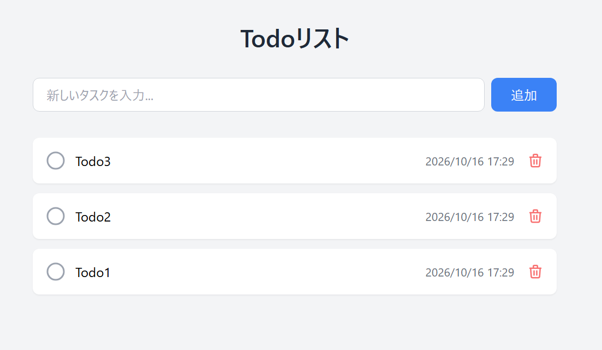
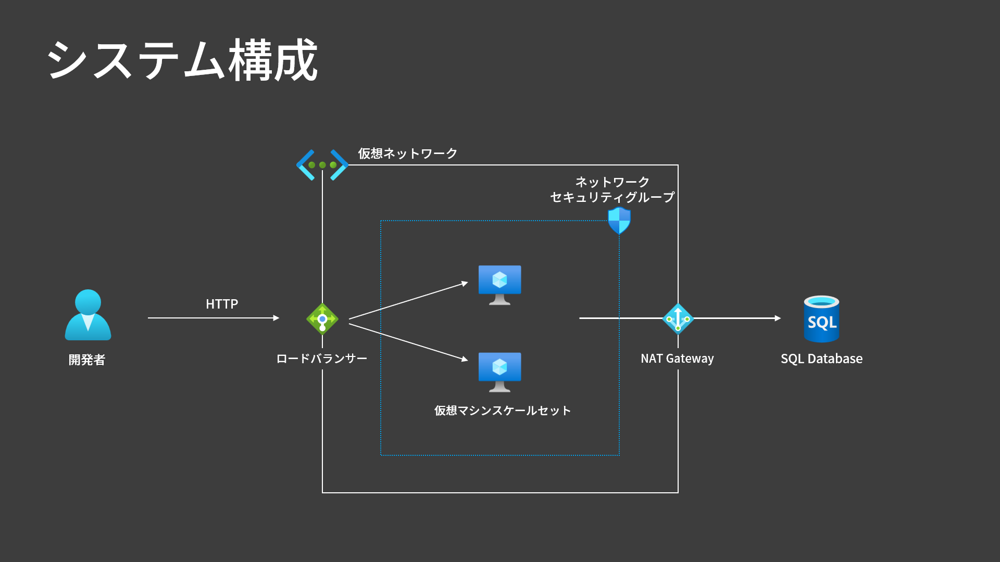

# 作りながら覚える Microsoft Azure 入門講座（IaaS 編）

Azure の [動画講座](https://www.udemy.com/course/microsoft-azure-iaas-part/) で取り上げる Todo アプリと、環境構築に使用する Terraform のソースコードを管理するリポジトリです。

シンプルな Todo アプリの構築を通じて、仮想マシンの作成から Web サーバーとデータベースの構築、ロードバランサーによる負荷分散、仮想マシンスケールセットによる自動スケールまでを学習します。



## インフラ構成図



## 使用技術

アプリ

- Python 3.12 / Flask（サーバーサイドレンダリング）
- SQLAlchemy Core / pyodbc（ORM は使いません）
- gunicorn（WSGI サーバー）
- uv（パッケージ管理）

インフラ

- Azure VM（Ubuntu 24.04 LTS） / nginx（リバースプロキシ）
- Azure SQL Database（サーバーレス・無料オファー）
- Terraform（コース内ラボの環境構築）

バージョンと調達元は[設計書の「技術スタック」](docs/design.md#1-技術スタック)にあります。

## デプロイ

**どちらも講師のデバッグ用です。** 受講者が演習で使うラボは [`labs/README.md`](labs/README.md) にあります。

### ローカルで動かす

```bash
uv sync
cp src/.env.sample src/.env   # 接続情報を記入する
uv run python src/app.py      # http://127.0.0.1:5000
```

### Azure で動かす

Azure Cloud Shell（Bash）で 1 行実行すると、完成形の環境ができます。

```bash
curl -fsSL https://raw.githubusercontent.com/m-oka-system/microsoft-azure-iaas-part/refs/heads/main/labs/sections/section99/setup.sh | bash
```

## クリーンアップ

Azure ポータルまたは Azure CLI で、リソースグループごと削除します。

```bash
az group delete --name <resource-group-name> --yes
```

## プロジェクト構造

```text
.
├── src/                  # Todo アプリ
│   ├── app.py            #   アプリ本体（1 ファイルで完結）
│   ├── .env.sample       #   接続情報のテンプレート
│   └── templates/        #   一覧・エラーの案内・実行環境の表示
├── deploy/               # VM の中へアプリを配置するスクリプト
│   ├── setup.sh          #   VM 用
│   ├── vmss-portal-setup.sh # VMSS 用
│   ├── todo.service      #   systemd unit
│   └── todo.nginx.conf   #   nginx の設定
├── labs/                 # コース内ラボ
│   ├── modules/          #   全ラボで共有する Terraform モジュール
│   └── sections/         #   演習ごとの Terraform
├── reference/            # 受講者向けの補足資料（コマンド集・参考サイト）
├── docs/                 # 要件定義書・設計書
├── tests/                # pytest
└── scripts/              # ラボ共通の起動処理と検証
```

## 開発

```bash
uv run pytest                                 # テスト
uvx ruff check --fix . && uvx ruff format .   # 静的解析と整形
./scripts/check.sh                            # コミット前の検証（全項目）
```

`check.sh` は Terraform の `validate`、プロバイダのバージョン固定、シークレットの混入、シェルの構文、Python、文書内のリンクをまとめて検証します。CI は導入していないため、これが唯一の機械的な検証です。
